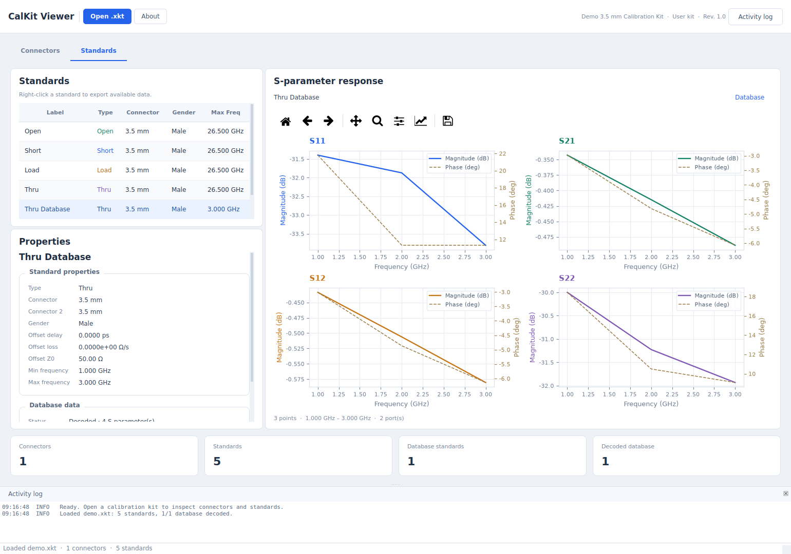
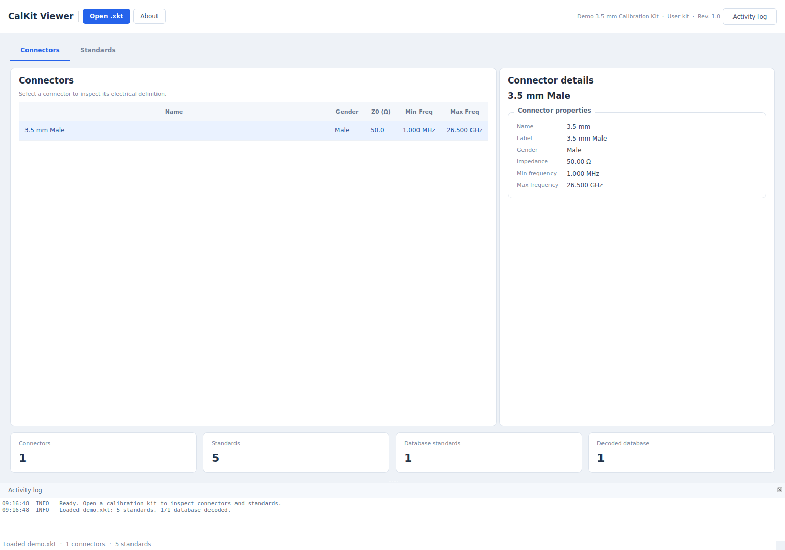

# CalKit Viewer

Keysight `.xkt` 校准套件的解析、解码、查看和导出工具。Python ≥ 3.10，PyQt6、matplotlib、numpy，使用 uv 管理依赖。

本工程以提供的功能源码为基准重新组织：保留 `Standard.std_type`、`num_ports`、`raw_s_data` 等字段；采用 `FrequencyLists/Stimulus/Segments/Arbitrary`、`DataBasedArrays` 端口映射和 `AccuracyArrays/AccuracyData` 结构。

## 快速运行

安装 [uv](https://docs.astral.sh/uv/getting-started/installation/)，然后在仓库根目录执行：

```powershell
uv sync --locked
uv run --locked xkt-viewer
# 打开附带示例
uv run --locked xkt-viewer examples/demo.xkt
# 兼容原入口
uv run --locked python xkt_viewer.py "C:\CalKits\85058B.xkt"
# 包入口
uv run --locked python -m calkit_viewer examples/demo.xkt
```

uv 自动创建 `.venv` 并安装本项目，无需手动激活环境。默认安装运行依赖及 dev 组；仅运行可使用 `uv sync --locked --no-dev` 和 `uv run --locked --no-dev xkt-viewer`。
PyCharm / VS Code 选择 `.venv` 解释器即可开发。

## 功能

- 读取 XML 或 ZIP 封装的 `.xkt`，支持 XML namespaces、UTF-8/UTF-16；错误与非致命解析警告分别处理。
- Connectors 页显示连接器、性别、阻抗和频率范围；Standards 页显示类型、端口连接器、Offset 和多项式系数。
- 普通 Base64 小端 double 数据解码；AgilentData 按提供的 33 字节表执行单元反转/XOR，然后转复数。
- Database 标准件按其频率轴绘制幅度与相位；经典标准件使用提供源码中的近似模型。
- 导出 Touchstone RI 格式，二端口顺序为 S11/S21/S12/S22；不完整矩阵不导出。
- 导出协方差 Vr2/Vri/Vi2 或 scalar 不确定度 CSV，按每条目的独立频率轴输出。
- 浅冷灰背景、白色卡片、蓝色主按钮；左侧列表与属性，右侧 2×2 图形，底部套件摘要和活动日志。
- 后台线程加载、解析提示、窗口/分隔条/最近目录记忆；读取失败时保留上一套件。

经典模型已从 GUI 移到 `model_response.py`。为保留原计算口径，仍使用 50 Ω、1000 点和原多项式公式；**未将原算法替换为其他带 Offset loss/Z0 修正的模型**。低最高频率时原网格首点 1 MHz 可能不递增，导出会拒绝该网格。此项是原近似模型的限制。
Touchstone 默认参考阻抗为 50 Ω；Python API 可通过 `write_snp(path, standard, z0=...)` 指定。Offset Z0 不被自动当作系统参考阻抗。
本版不新增不确定度绘图计算，保留不确定度 CSV 导出。

## 界面预览

以下预览由本工程实际读取合成示例生成：





## 工程结构

```text
calkits_viewer/
├── pyproject.toml / uv.lock       项目信息、依赖和锁文件
├── AGENTS.md                     工程约定
├── xkt_viewer.py                  兼容 GUI 入口
├── calkits_viewer.py              兼容早期 GUI 入口
├── xkt_parser.py                  兼容解析 API
├── calkit_model.py                兼容数据模型导入
├── calkits_model.py               兼容复数文件名导入
├── utils.py                       兼容解码与导出 API
├── src/calkit_viewer/
│   ├── models.py                  数据模型与逐字段说明
│   ├── parser.py                  XML/ZIP 读取、校验与数据组装
│   ├── decoding.py                Base64 / Agilent 解码
│   ├── model_response.py          经典标准件近似响应
│   ├── export.py                  Touchstone / CSV 导出
│   └── gui/
│       ├── app.py                 程序入口、字体、日志配置
│       ├── window.py              主窗口与后台读取线程
│       ├── pages.py               Connectors / Standards 页面
│       ├── plot.py                绘图组件
│       ├── helpers.py             属性标签、卡片和表格组件
│       └── theme.py               样式与固定对象配色
├── examples/demo.xkt              合成 SOLT + database 示例
├── tests/                        核心与 GUI 集成测试
└── packaging/                    PyInstaller 配置
```

根目录文件是兼容入口，不再各自维护一份功能实现。算法模块不依赖 Qt。

## Python API

```python
from calkit_viewer import parse_xkt
from calkit_viewer.export import write_snp, write_uncertainty_csv
from calkit_viewer.model_response import calculate_model_response

kit = parse_xkt("85058B.xkt")
standard = kit.standards[0]
# database 直接使用 standard.s_params；经典件可单独计算模型
if not standard.is_database_type:
    modeled = calculate_model_response(standard)
write_snp("standard.s1p", standard)
write_uncertainty_csv("standard_uncertainty.csv", standard)
```

导出扩展名应与实际端口数匹配；没有对应数据的导出会抛出明确异常。
`raw_data` / `agi64_raw_data` 字段保留原 XML 的 Base64 文本；三个解码函数也接收 Base64 文本，不接收已解码二进制。解码后的数组检查长度、有限性和频率一致性。

## 测试与依赖管理

```powershell
uv run --locked pytest -q
uv run --locked ruff check .
uv run --locked ruff format --check .
uv lock --check
# 修改依赖
uv add <包名>
uv add --dev <包名>
uv lock --upgrade
```

Linux 无显示器测试：`QT_QPA_PLATFORM=offscreen uv run --locked pytest -q`。
`uv.lock` 应和 `pyproject.toml` 一起提交；不要维护第二套 requirements 文件。

## Windows 打包

在仓库根目录、Windows 系统上运行：

```powershell
uv run --locked --group build pyinstaller packaging/calkits_viewer.spec
```

输出 `dist/CalKitViewer/CalKitViewer.exe`，分发时复制整个目录。Linux 无法生成 Windows EXE；本次未对 Windows EXE 进行验收。

## 验证范围

附带示例是按提供的 XML 结构生成的合成测试数据，**不能作为校准依据**。
核心与 GUI 集成测试覆盖实际读取、解码、绘图、导出和错误处理；真实 Keysight `.xkt` 与计量结果的一致性仍需用实物文件验收。详见 `VALIDATION.md`。
